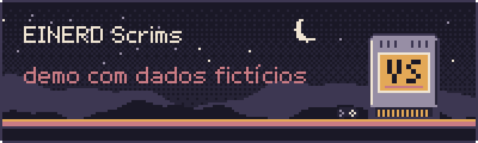
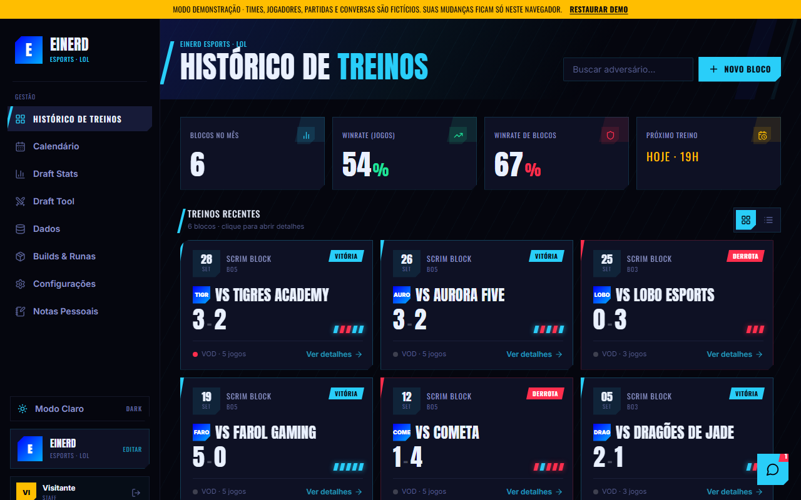
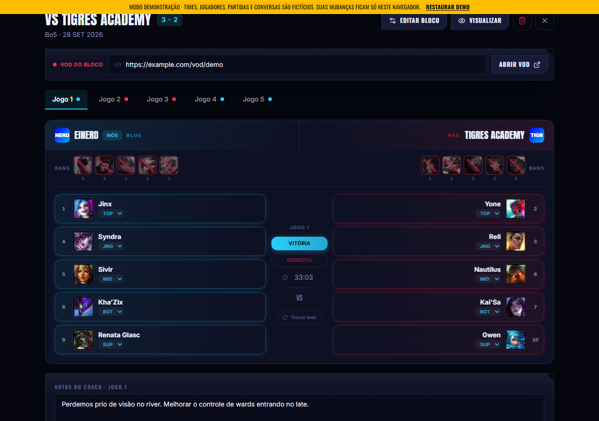
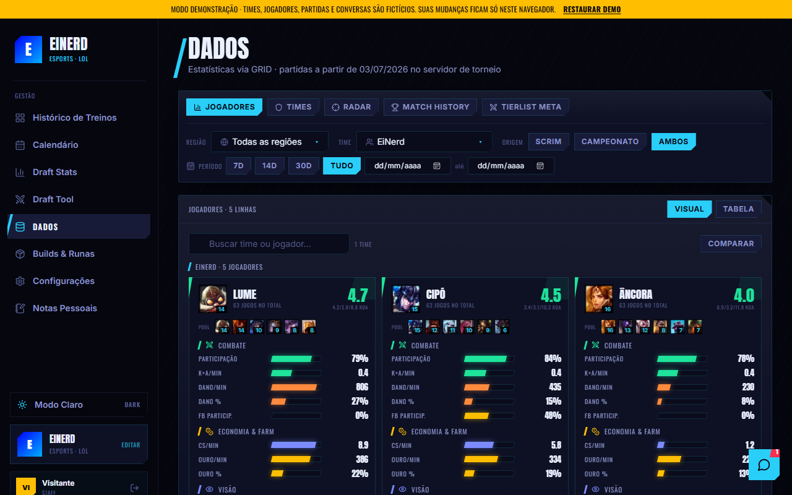
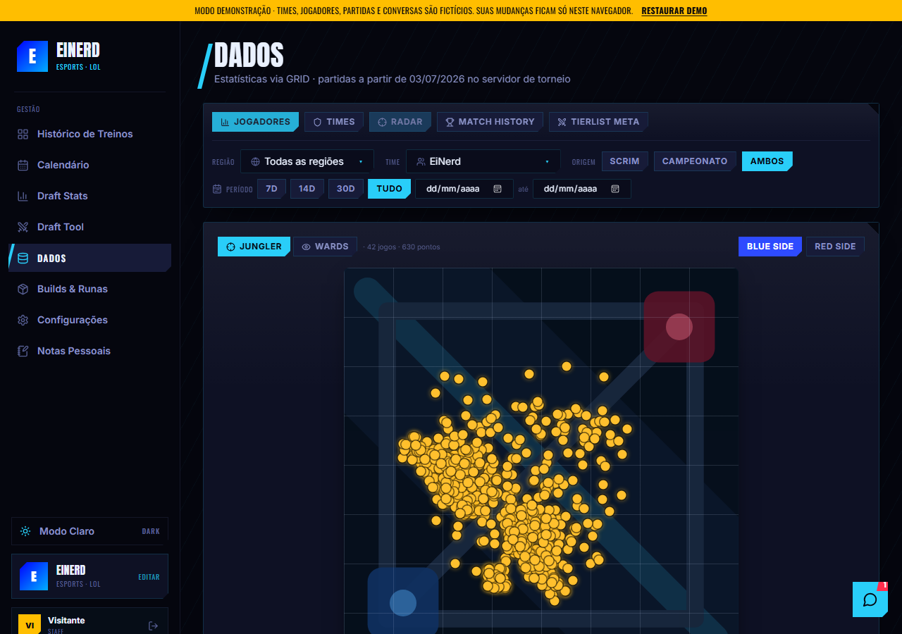

<p align="center">
  
</p>

<p align="center">
  <b>EiNerd Scrims — demonstração.</b><br>
  Um sistema para um time de League of Legends organizar seus treinos: histórico de blocos com o draft de cada jogo, estatísticas, calendário e uma área de dados de partidas.
</p>

<p align="center">
  <a href="https://einerd-scrims-demo.vercel.app"><b>Abrir a demo</b></a> ·
  <a href="#como-rodar">Como rodar</a> ·
  <a href="docs/README.md">Documentação</a> ·
  <a href="https://eduardohenrique-nu.vercel.app">Portfólio</a>
</p>

<p align="center"></p>

> ### Isto é uma demo
> O EiNerd Scrims é uma ferramenta **interna** de um time de esports, com treinos, drafts e dados de partidas reais, então o código original é privado. Este repositório é a **versão de demonstração**: a mesma interface, rodando sobre **dados 100% fictícios** que vivem no navegador. Times, jogadores, partidas, estatísticas e conversas são inventados, e não há banco, conta real nem chave de serviço nenhuma aqui.

<p align="center">
  
  
</p>
<p align="center">
  
  
</p>

## O que o app faz

| Tela | O que faz |
| --- | --- |
| **Histórico de Treinos** | Painel dos blocos (sessões de treino contra um adversário): blocos no mês, winrate, próximo treino e a lista de blocos |
| **Bloco** | Cada jogo do bloco com resultado, duração, lado, **draft completo** (5 bans e 5 picks por lado, com rota e jogador), notas do coach e o link do VOD |
| **Calendário** | Scrims, reviews, reuniões e folgas. Criar uma scrim gera o bloco correspondente no histórico |
| **Draft Stats** | Winrate por campeão e por jogador, calculado a partir dos blocos |
| **Draft Tool** | Simulador de pick e ban na ordem oficial do draft competitivo |
| **Dados** | Estatísticas de partidas (formato dos dados da GRID): jogadores, times, radar do jungler e das wards, histórico de partidas e tier list do meta |
| **Builds & Runas** | Builds e runas mais usadas por campeão e rota, e os confrontos diretos |
| **Notas Pessoais** | Caderno de matchups, anotações livres com cores e tier list pessoal |
| **Configurações** | (admin) times, jogadores, campeões, tipos de evento, backup em JSON |
| **Chat** | Mensagens diretas entre os usuários, num widget flutuante |

## Como a demo funciona

- **Sem servidor e sem banco.** Os dados vivem no navegador: um banco em memória imita a API do Supabase, e uma cópia fica no `localStorage`. O que você muda vale só para você.
- **Restaurar.** A faixa amarela no topo tem o botão **Restaurar demo**, que volta tudo ao início.
- **Entra direto.** Você abre como **Visitante** (admin). Para testar o outro papel, saia e entre como `Lume` (jogador) com a senha `demo`.
- **Dados inventados.** As partidas da área Dados são geradas por um sorteio com semente fixa: sempre o mesmo resultado, sem nada vindo da GRID ou da Riot.

Os detalhes estão em [como a demo funciona](docs/modo-demo.md).

## Como rodar

Precisa de Node.js 20 ou mais novo.

```bash
git clone https://github.com/eduardohenrique-dev/einerd-scrims-demo.git
cd einerd-scrims-demo
npm install
npm run dev
```

Abra <http://localhost:5181>. Para os testes e o build:

```bash
npm test
npm run build && npm run preview
```

## Stack

| Camada | Tecnologia |
| --- | --- |
| Interface | React 18 |
| Bundler | Vite 6 |
| Estilo | Tailwind CSS 3, com tema escuro e claro |
| Ícones | lucide-react |
| Testes | Vitest |
| Dados da demo | banco em memória com um imitador do `supabase-js` |

## Documentação

- [Como a demo funciona](docs/modo-demo.md)
- [Funcionalidades](docs/funcionalidades.md)
- [Dados e estatísticas](docs/dados-e-estatisticas.md)
- [Arquitetura](docs/arquitetura.md)
- [Desenvolvimento](docs/desenvolvimento.md)

---

<sub>Os nomes de times, jogadores e partidas desta demo são fictícios. Os ícones dos campeões vêm do Data Dragon, o CDN público da Riot Games, e são carregados no navegador; nada da Riot é distribuído neste repositório. EiNerd Scrims não é endossado pela Riot Games e não reflete as opiniões da Riot Games ou de quem trabalha com propriedades da Riot Games. Riot Games e todas as marcas associadas são marcas registradas da Riot Games, Inc.</sub><br>
<sub>A marca Ei Nerd pertence aos seus titulares. Feito em Governador Valadares (MG). Código publicado para consulta; todos os direitos reservados.</sub>
